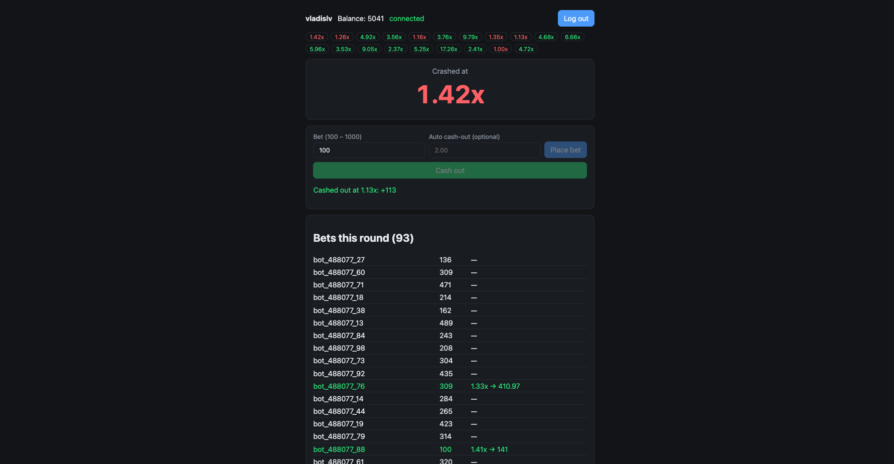
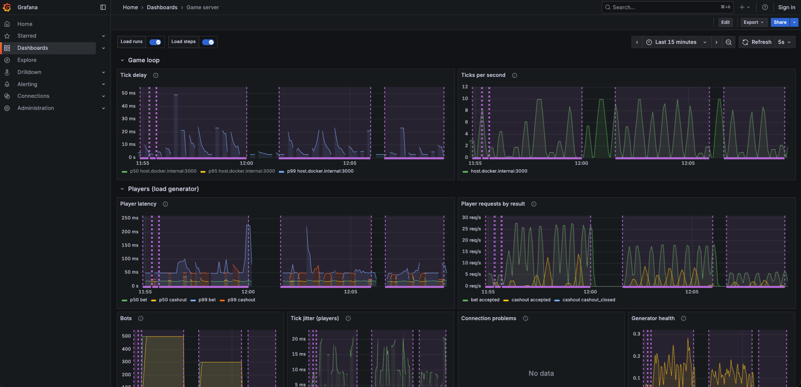
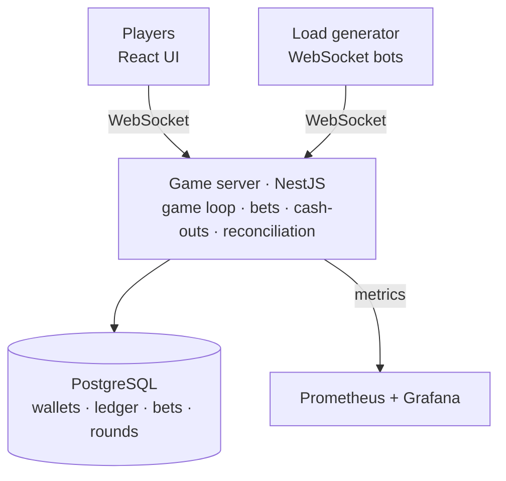
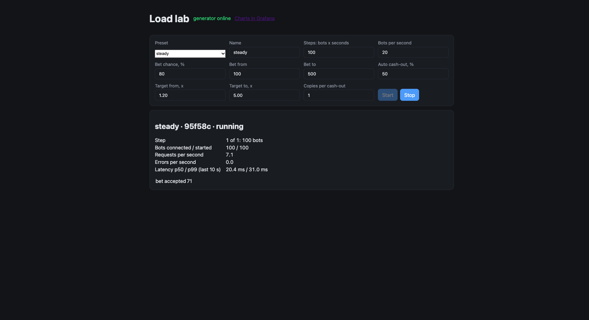

# Crash Game

A multiplayer crash game (iGaming) over WebSockets, built to learn and experiment with scaling, observability and money safety. Players bet during a 15 s betting phase, watch the multiplier grow and cash out before the round crashes. The server is authoritative: the client never decides the multiplier, the crash point or a payout.



## Highlights

- **Money safety.** Every balance change has a ledger entry; bets and cash-outs are idempotent, so a client can retry after a reconnect without paying twice ([ADR-0004](docs/adr/0004-wallet-and-bet-settlement.md)).
- **Crash recovery.** After a restart the server continues the last round or voids it and refunds the stakes; a graceful shutdown drains money operations in flight.
- **Reconciliation.** A job checks 8 money invariants every minute and on demand: balances against the ledger, bets against payouts ([ADR-0007](docs/adr/0007-reconciliation.md)).
- **Observability.** One structured log event per unit of work, Prometheus metrics and a Grafana dashboard ([ADR-0005](docs/adr/0005-structured-logging.md), [ADR-0006](docs/adr/0006-metrics.md)).
- **Load lab.** Thousands of WebSocket bots driven from a page, with every run marked on the dashboard ([ADR-0008](docs/adr/0008-load-generator.md)).



Built with AI-assisted development; design decisions and trade-offs are documented in [ADRs](docs/adr), the roadmap in [docs/plan.md](docs/plan.md).

## Architecture



## How the game works

Rounds run one after another, driven by the server's game loop ([ADR-0002](docs/adr/0002-game-core-design.md)):

1. **Betting, 15 s.** Before it opens, the server draws the crash point (1% house edge, capped at 10 000x) and stores it with the round. Players place one bet each, optionally with an auto-cashout target.
2. **Running.** The multiplier grows as `e^(0.000107 · t)` (2x at about 6.5 s). Every 100 ms the server broadcasts a **tick** with the current multiplier. Ticks are display-only: the client draws the curve itself and ticks correct its drift.
3. **Crashed.** At the precomputed moment the multiplier reaches the crash point and the round crashes. Bets not cashed out lose.
4. **Pause, 5 s.** Then the next round opens betting; on opening, a settlement sweep settles every bet still open from earlier rounds.

A cashout is valid if the multiplier at the moment the server **received** it is below the crash point; ticks never decide money. Money moves in PostgreSQL transactions, so a bet is debited once and a cashout pays once even under retries ([ADR-0004](docs/adr/0004-wallet-and-bet-settlement.md)).

## Stack

NestJS game server with raw `ws`, PostgreSQL (TypeORM), a React + Vite client, pino logs, Prometheus metrics and Grafana dashboards. See [ADR-0001](docs/adr/0001-tech-stack.md).

| Path                  | What                                                           |
| --------------------- | -------------------------------------------------------------- |
| `apps/game-server`    | game loop, bets and cashouts, WebSocket gateway, logs, metrics |
| `apps/web`            | player UI and load lab page                                    |
| `apps/load-generator` | WebSocket bots for load runs                                   |
| `packages/contracts`  | WebSocket message types shared by server and client            |
| `ops/`                | Prometheus config, Grafana provisioning and dashboards         |
| `docs/`               | plan, state, ADRs, observability guide, experiment write-ups   |

## Running locally

Requires Node 24.9+ (`.nvmrc`) and Docker. The server and the client each run in their own terminal:

```bash
npm install
docker compose up -d
npm run start:dev -w game-server
npm run dev -w web
```

The game server listens on port 3000 and applies migrations on start; the client runs on http://localhost:5173. `npm run verify` runs formatting, lint, type checks, unit and integration tests.

## Observability

Details for everything below are in [docs/observability.md](docs/observability.md).

- **Logs.** One JSON event per unit of work on stdout, pretty-printed by `start:dev` ([ADR-0005](docs/adr/0005-structured-logging.md)).
- **Money reconciliation.** Runs every minute; `npm run reconcile -w game-server` checks the money on demand and exits with code 1 on any mismatch ([ADR-0007](docs/adr/0007-reconciliation.md)).
- **Metrics.** `docker compose --profile observability up -d` starts Prometheus (http://localhost:9090) and Grafana (http://localhost:3001, dashboard **Game server**) ([ADR-0006](docs/adr/0006-metrics.md)).

## Load lab

With the game server and the client running, start the bots and open http://localhost:5173/lab ([ADR-0008](docs/adr/0008-load-generator.md)):

```bash
npm start -w load-generator
```

Pick a preset or edit the scenario and press Start. Every run and step is marked on the Grafana dashboard.



## Load simulations

Before the load generator existed, load was hardcoded into the server to see how the metrics react. Full write-ups: [docs/experiments/load-simulations.md](docs/experiments/load-simulations.md).

- **Blocking the event loop** for 100 ms a second leaves the median tick delay near 0 but pushes p99 to ~100 ms: averages hide it, tail percentiles show it.
- **One huge short-lived array** barely costs the garbage collector; the lag comes from filling it on the main thread.
- **A million small live objects** delay ticks by ~80 ms at p99: GC cost follows the number of live objects, not bytes.

## Planned experiments

Each experiment gets a full write-up in [docs/experiments](docs/experiments) (setup, results, conclusions) and a short summary here once it runs. The order of the performance runs, their pass criteria (SLOs) and the test environment are in the [performance test plan](docs/experiments/performance-test-plan.md).

| #   | Experiment                                                              | Status                                |
| --- | ----------------------------------------------------------------------- | ------------------------------------- |
| 1   | Max connections before p99 grows                                        | runnable with the load lab            |
| 2   | Several instances behind a load balancer, Redis pub/sub                 | needs horizontal scaling              |
| 3   | Kill an instance mid-round: no lost bets or payouts                     | runnable on one instance              |
| 4   | Concurrent duplicate cashouts: paid exactly once                        | runnable: `duplicate-cashouts` preset |
| 5   | Wallet concurrency: isolation levels and row locks in PostgreSQL (MVCC) | runnable                              |
